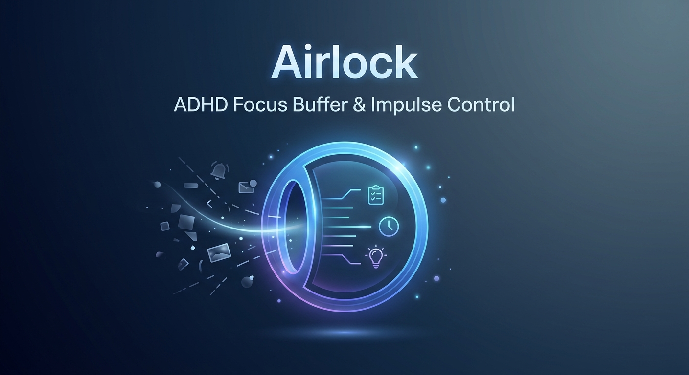

  

<h1 align="center">Airlock</h1>

  <b>A buffer zone between an impulse and the action it triggers.</b> 
  A Chrome extension built for ADHD brains. 100% local, zero telemetry.

  
  
  
  

---

## ⚡ In 10 seconds

You're working. An idea pops up and it feels **urgent**.

1. Hit <kbd>Ctrl</kbd>+<kbd>Shift</kbd>+<kbd>E</kbd> (<kbd>Cmd</kbd>+<kbd>Shift</kbd>+<kbd>E</kbd> on Mac)
2. Type the idea, press <kbd>Enter</kbd>
3. Airlock asks one question: ***does this go first?***

| Key | Answer | What happens |
|:---:|---|---|
| <kbd>1</kbd> | **→ switch** | The idea becomes your focus, the old focus waits at the front of the queue |
| <kbd>2</kbd> | **queue** | The idea waits its turn, you keep going |
| <kbd>3</kbd> | **drop** | Gone. And that's perfectly fine |

That's it. The idea is safe, and you didn't dive in. 🎯

---

## 🧠 Why it exists

With ADHD, a new idea doesn't feel like a distraction: it feels like the most important
thing in the world. By the time you surface, what you were doing is gone.

| The struggle | What Airlock does |
|---|---|
| 🌀 The new idea hijacks you | Takes it seriously, writes it down, asks you to rank it |
| 🫧 Unwritten = forgotten | Capture costs 2 seconds: one shortcut, one field, Enter |
| 🧭 "What was I doing?" | One single focus, always visible |
| 👀 Out of sight, out of mind | A reminder card on `claude.ai` (or every site, if you want), plus the icon tooltip |
| 🧗 "Where do I even start?" | Break the focus into tiny steps; the next one follows you around |
| 😬 Misclicks | Every removal can be undone for a few seconds |
| 😔 Guilt of the endless list | `drop` is a real answer. No streaks, no score, no nagging |

> Airlock is not a medical device or a therapy. It's an ordinary productivity tool whose
> design was made *for* ADHD brains, not adapted to them afterwards. Works great without
> ADHD too.

---

## 🚀 Install (2 min)

1. Clone the repo somewhere stable, e.g. `~/extensions/airlock/`
2. Open `chrome://extensions/` and turn on **Developer mode** (top right)
3. Click **Load unpacked** and pick the cloned folder
4. Pin it to the toolbar (puzzle icon, then the pin) 📌

> [!TIP]
> **Updating later:** run `git pull` in the folder **already loaded**, then click
> **Reload** on the extension card. Loading from another path starts with empty storage
> (your data isn't lost, it just stays with the old path).

Not on the Chrome Web Store yet: it runs unpacked for now.

---

## 🎮 Everyday use

- ✅ **Done with your focus?** Click ✓. The next item in the queue takes over automatically.
- ↩️ **Oops?** An **undo** link shows for a few seconds (<kbd>Ctrl</kbd>+<kbd>Z</kbd> works too).
- ❓ **Closed the popup before answering?** The idea is kept and a `?` waits on the icon.
- 🪜 **Stuck?** "découper en étapes" splits the focus into steps; the first unticked one
  shows in the popup, the tooltip and the reminder card.
- 📋 **In the queue:** `→` makes it the focus, `↑` moves it up, `×` deletes it.

---

## 🛡️ Your data stays yours

- 💾 Everything lives in `chrome.storage.local`, on your machine
- 🚫 No server, no account, no sync, no telemetry, no analytics
- 🔑 Minimal permissions; site access and `nativeMessaging` are only asked when you turn
  on the matching feature
- 📦 JSON export / import on the Options page: your backup, your control

One optional exception: the **"Générer avec Claude"** step generator runs `claude -p`
locally through a host you install yourself. Off by default, and only the one idea you
act on is sent. Details in the [privacy policy](https://kiyomasanaki.github.io/airlock/privacy-policy.html).

---

## 🙅 What it is *not*

Not a task manager. No projects, no due dates, no tags, no priorities, no account, no
notifications, no AI reshuffling your work. **One focus, one queue, today's wins.**

---

## 📚 More details

<b>⌨️ Keyboard shortcut not working?</b>

 

Chrome only binds the shortcut at install, and silently skips it if something else
already uses it. Airlock tells you, without any extra permission:

- **At install:** the Options page opens once, with a button to `chrome://extensions/shortcuts`
- **On the icon:** a `!` badge stays until a shortcut is bound (re-checked at startup, on
  data changes and when Options opens). "Ne plus afficher" turns it off.
- **On claude.ai** (or every site if opted in): pressing the unbound shortcut shows a
  warning bottom right. Seeing it means the extension works, only the shortcut needs setting.

Chrome limits: the shortcut only works while Chrome is the active app; for a global one,
use `Ctrl+Shift+[0-9]`.

<b>📌 The reminder card</b>

 

A small draggable card, bottom right, showing your focus and its next step:

- **claude.ai/new or home:** always, so you remember your focus before a new conversation
- **An existing claude.ai conversation:** only if a focus is set
- **Every other site:** opt-in from the Options page ("Rappel du focus sur tous les sites");
  turning it off removes the permission

One click on the cross hides it until the next page. No page content is ever read.

<b>⚙️ The Options page</b>

 

Right-click the icon, then **Options**. The popup stays tiny; the heavy stuff lives here:

- Reminder on every site (opt-in)
- JSON export and import (1.0 exports still accepted)
- Full history of completed items, grouped by day
- Current shortcut, with a link to change it

<b>📐 Design rules (and why)</b>

 

Each rule is a constraint, not a preference: it's what keeps the tool usable on a bad day.

| Rule | Why |
|---|---|
| One shortcut, one field, Enter | Capture must cost less than acting on the impulse |
| Exactly one active focus | The decision is always binary against a single incumbent |
| Three answers: switch, queue, drop | A bounded choice, not a planning session |
| `drop` is legitimate | Discarding is a valid outcome, not a failure |
| No dates, projects, tags or account | Every extra field is a place to stall |
| No notifications, streaks, score or time tracking | Nothing that becomes another source of pressure |
| Heavy things live on the Options page | The popup stays usable without thinking |
| Next item auto-promoted on ✓ | Finishing shouldn't require deciding what's next |
| Keys 1, 2, 3 | The whole loop works without the mouse |
| Undo instead of confirmation dialogs | A misclick never costs an idea |
| Nothing captured is ever lost | An unanswered capture is saved and flagged with `?` |

<b>🛠️ Hacking on it</b>

 

Plain HTML/CSS/JS, zero dependencies, zero build step. Edit, then click **Reload** on
the extension card in `chrome://extensions/`.

| Path | Role |
|---|---|
| `manifest.json` | Manifest V3 config, must stay at the repo root |
| `js/state.js` | Shared state helpers, loaded by every surface |
| `js/background.js` | Service worker: icon tooltip and badge, "every site" reminder |
| `pages/popup.html`, `js/popup.js`, `js/theme.js` | The airlock itself |
| `pages/options.html`, `js/options.js` | Options: export/import, history, shortcut |
| `pages/methodology.html`, `js/methodology.js`, `css/methodology.css` | Step breakdown view |
| `js/content.js`, `css/content.css` | Reminder card |
| `icons/` | Extension icons |
| `docs/` | Roadmap, publishing guide, Store listing, legal pages (GitHub Pages site) |

The packaging script and the optional native-messaging bridge are kept outside this repo.

---

## 🗺️ Status & links

- 🚧 **Phase 2** (polish before publication) in progress; phases 0 and 1 are done
- 🌐 Interface in **English and French**, switchable live from the Options page (defaults to the browser language)
- 🗺️ [Roadmap](docs/roadmap.md) · 📤 [Publishing guide](docs/publishing.md) · 🔒 [Privacy & legal](https://kiyomasanaki.github.io/airlock/)

MIT licence · see <a href="LICENSE">LICENSE</a>

